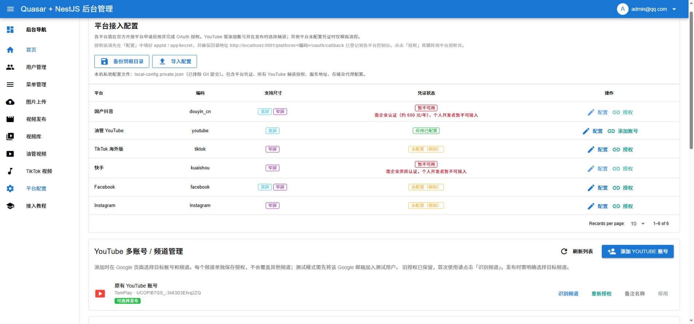
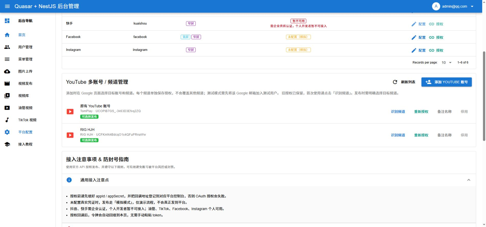
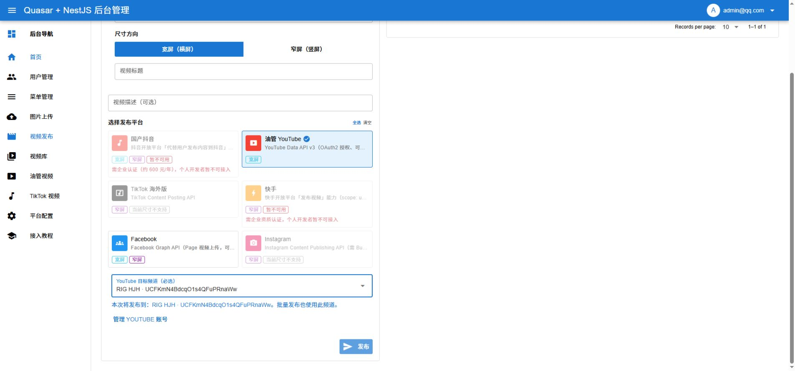

# YouTube 多账号与频道选择

同一个本地项目可以保存多个 YouTube 频道的授权。Google Cloud 应用凭证可以共用，各频道的授权令牌独立保存。原有授权会迁入账号管理，不会被新增账号覆盖。

## 添加另一个频道

1. 打开[平台配置](http://localhost:5173/#/platform-config)，找到「YouTube 多账号 / 频道管理」。
2. 原有账号若显示「待识别频道」，先点击「识别频道」，检查返回的频道名称和 `UC…` 频道 ID。
3. 点击「添加 YouTube 账号」，在 Google 授权页面登录目标频道所属账号。出现频道选择时，选择实际要发布的频道；Google 登录由账号本人完成。
4. 应用处于测试模式时，需要先在 Google Cloud 的[目标对象 → 测试用户](https://console.cloud.google.com/auth/audience?project=shanbo-search-console)中添加实际授权邮箱。
5. 授权成功后返回本系统，确认新增行的频道名称、ID 和「可选择发布」状态。可设置备注名称，也可停用暂不使用的账号。
6. 点击「备份到根目录」，把多个频道的授权一起保存进已被 Git 忽略的 `local-config.private.json`。

「重新授权」只更新该行对应的频道。若 Google 选成另一个频道，系统会拒绝保存；要增加不同频道，请使用「添加 YouTube 账号」。同一个频道再次添加会更新它自己的授权，不会创建重复行。账号停用后，未执行或重试的任务不会改用其他账号。

## 新账号报 403 时的最简处理（实操截图）

2026-10-07 实操：新账号登录时出现 `403 access_denied`，页面明确提示应用正在测试、仅限获批测试人员。已在原来的 Google Cloud 项目中添加该账号为测试用户，并确认列表同时保留原账号。添加名单不等于频道已经授权，需要继续下面的登录授权。

1. 用管理应用的原 Google 账号进入 **[Google Auth Platform → 目标对象 / 测试用户](https://console.cloud.google.com/auth/audience?project=shanbo-search-console) → Add users**。
2. 填实际频道所属的 Google 邮箱，按 Enter 确认后点击「保存」。无需新建项目、Client ID 或密钥。
3. 在名单中确认新邮箱已经出现。上方人数统计不是名单本身，不用等待统计数字变化。
4. **如果目标账号登录在另一个 Chrome 用户窗口，应在那个窗口地址栏打开 [本地平台配置页面](http://localhost:5173/#/platform-config)。** 浏览器用户窗口各自保存登录状态，原窗口的账号选择页可能只显示原账号。
5. 如本地后台要求登录，先登录本地管理员，再点击「添加 YouTube 账号」。Google 页面选择目标账号和频道，由账号本人确认授权。也可在原窗口选「使用其他账号」，但需要重新登录目标账号。
6. 授权返回后，核对多账号列表中新增频道的名称和 ID；再点击「备份到根目录」。后续发布时选择这个频道。

（填写新的测试用户邮箱：涉及账号隐私，截图仅保存在本机。）

（保存后两个邮箱都在测试用户名单中：涉及账号隐私，截图仅保存在本机。）

（原 Chrome 窗口只显示原账号，可选使用其他账号：涉及账号隐私，截图仅保存在本机。）

Google Cloud 项目管理员、本地后台管理员和实际 YouTube 频道账号是三种不同身份，不必相同。在项目管理员窗口添加测试用户，在目标频道账号窗口完成 Google 授权即可。看到另一个窗口的截图不代表浏览器控制工具已经连接到那个 Chrome 用户窗口。

测试模式下，本项目所请求的 YouTube 授权会在 7 天后过期，需要重新授权；见 [Google 测试用户说明](https://support.google.com/cloud/answer/15549945?hl=en)。

### 在目标账号窗口完成授权

添加测试用户后，原来的 403 拦截变为「此应用未经 Google 验证」提示。核对这是自己创建的应用，再由账号本人继续；下一页核对登录邮箱及请求的「管理 YouTube 视频」「查看 YouTube 账号」权限。下面两张图由用户在目标账号窗口提供，授权确认由用户本人完成。

（测试应用提示：涉及账号隐私，截图仅保存在本机。）

（目标账号的授权确认页：涉及账号隐私，截图仅保存在本机。）

### 本次实际结果

2026-10-07，授权返回后已在本地后台确认两个频道同时存在，状态均为「可选择发布」：

| 频道 | 频道 ID |
| --- | --- |
| TomPlay | `UCOPlB7GS_-3k63D3Efvq2ZQ` |
| RIG HJH | `UCFKmN4BdcqO1s4QFuPRnaWw` |

已点击「备份到根目录」，页面确认备份了 6 个平台、2 个 YouTube 账号及环境配置。授权令牌保存在被 Git 忽略的本机私密配置文件中，不写入教程。

## 发布时选择频道

1. 打开[视频发布](http://localhost:5173/#/publish)，选择视频并填写标题。
2. 勾选「油管 YouTube」，在「YouTube 目标频道（必选）」中选择频道。
3. 核对下方显示的频道名称和 ID，再点击发布。没有选择频道时不能提交 YouTube 发布任务。
4. 批量发布使用所选的同一个频道。如需发到另一个频道，请另建任务并选择另一个频道。
5. 任务详情保留创建时的频道名称和 ID。重试和结果查询仍使用该任务绑定的账号；其他账号的授权变化不会让任务切换频道。

上传前会用本次上传令牌核对 Google 返回的频道 ID，不一致就停止。重复检测按「视频内容 + 频道 ID」进行：在 A 频道已成功发布不会阻止新建 B 频道任务。同频道成功过的视频会跳过；模拟结果不作为真实已发布记录。

新增频道后，发布页已验证可以选择 RIG HJH，下方显示相同频道 ID。本次仅选择频道并截图，没有选择视频文件或提交发布。

[油管视频](http://localhost:5173/#/youtube-videos)页面也可以按频道切换查看。只有一个可用频道时可自动加载其列表；发布页始终要求主动选择。

## 原有任务和配置文件

升级前创建的任务没有频道绑定信息。它们仍保留，但不能直接重试 YouTube 发布；请重新选择频道创建任务，避免推测历史授权归属。新的配置备份使用版本 2，包含 `youtubeAccounts`；仍兼容旧版文件，规则见 [本机配置指南](LOCAL_CONFIG_GUIDE.md)。

## 验证范围

自动测试使用临时数据库和模拟接口验证多频道授权隔离、原授权迁移、频道必选、停用、重试绑定、按频道去重、错误频道拦截、OAuth 状态绑定及配置导入回滚。页面联调已确认 TomPlay 与用户本人授权的 RIG HJH 同时存在，并验证发布页可选 RIG HJH。没有通过测试上传或发布真实视频，尚未验证新增频道的实际上传。

## 视频列表、视频标题和视频详情

[视频发布](http://localhost:5173/#/publish)中，待上传列表支持单个或批量视频，批量中的每个视频分别填写标题和详情 / 描述；可点击「视频详情」预览文件。已上传记录可搜索标题和描述，点击标题或详情查看完整描述、视频预览与平台发布结果。

[油管视频](http://localhost:5173/#/youtube-videos)中，先选择频道再获取视频。分页列表展示封面、视频标题、详情摘要、时长、发布时间、可见性和播放量。点击标题或「视频详情」查看完整描述和其他指标。

2026-10-07 实际读取 RIG HJH 的 12 个视频，验证了搜索与详情弹窗。截图见项目内图文教程的「视频列表、标题与详情」。本次没有发布新视频；自动文件选择受 Chrome 扩展文件访问权限限制，未完成真实上传验证。

## 发布时选择列表

视频发布页选择目标频道后，可选已有播放列表，或点击新建列表创建并选中；留空直接发布。批量视频共用该列表，切换频道自动清空。旧授权需要包含 youtube.force-ssl 范围才能创建或写入列表，缺少权限时去平台配置重新授权。任务保存列表 ID 与名称；加入列表失败后重试已有视频，不重复上传。

图文教程：[发布时选择或新建列表](http://localhost:5173/guides/youtube.html#publish-playlist)。本次只读取真实列表、检查页面，写入使用模拟官方接口测试，未创建线上列表或发布视频。
